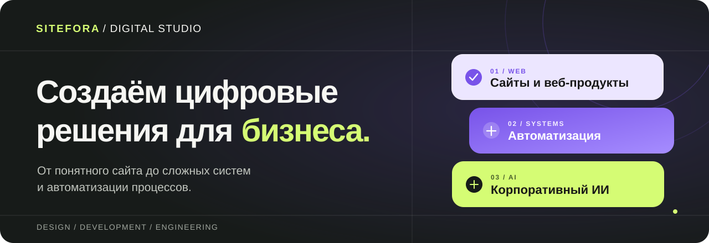

<picture>
  <source media="(prefers-color-scheme: dark)" srcset="./assets/sitefora-logo-dark.svg" />
  
</picture>

  

 

### Разработка, которая работает на задачи бизнеса.

Проектируем и создаём сайты, веб-продукты, автоматизацию и корпоративные ИИ-системы.  
Соединяем выразительный дизайн, инженерный подход и понятные бизнес-сценарии.

 

[**Наш сайт ↗**](https://sitefora.ru) &nbsp;·&nbsp; [**Смотреть проекты ↗**](https://sitefora.ru/portfolio) &nbsp;·&nbsp; [**Рассчитать проект ↗**](https://sitefora.ru/calculator) &nbsp;·&nbsp; [**Связаться ↗**](https://sitefora.ru/contacts)

---

## Чем мы занимаемся

<table>
<tr>
<td width="33%" valign="top">

### 01 / Сайты и дизайн

Лендинги, корпоративные сайты и интерфейсы. Продумываем структуру, адаптивность, доступность и пользовательский путь.

</td>
<td width="33%" valign="top">

### 02 / Автоматизация

Интеграции, Telegram-боты, API, обработка заявок и данных. Помогаем заменить рутину работающими сценариями.

</td>
<td width="33%" valign="top">

### 03 / Корпоративный ИИ

Локальные языковые модели, ИИ-ассистенты, поиск по внутренним документам и инфраструктура для размещения решений.

</td>
</tr>
</table>

## Наш подход

**01 — Понимаем задачу.** Начинаем с целей бизнеса, процессов и ограничений, а не со списка модных технологий.

**02 — Проектируем решение.** Формируем архитектуру, пользовательские сценарии и визуальную систему.

**03 — Разрабатываем и проверяем.** Уделяем внимание удобству, производительности, тестированию и безопасности.

**04 — Запускаем и развиваем.** Настраиваем инфраструктуру, наблюдаемость и основу для дальнейших изменений.

## Избранные работы

<table>
<tr>
<td width="50%" valign="top">

### [Commander ↗](https://commander-cli.ru/en)

Веб-проект с собственным интерфейсом и продуманной подачей продукта.

[Открыть проект](https://commander-cli.ru/en)

</td>
<td width="50%" valign="top">

### [Goldline Engineering ↗](https://goldlineing.ru/)

Корпоративное веб-присутствие инженерной компании.

[Открыть сайт](https://goldlineing.ru/)

</td>
</tr>
</table>

Больше работ и деталей реализации — в [портфолио SiteFora](https://sitefora.ru/portfolio). Здесь представлены публичные результаты работы, а не внутренние репозитории.

---

<table>
<tr>
<td width="64%" valign="middle">

### Знакомьтесь — наш маленький помощник.

Не вся сложная разработка должна выглядеть сложно.

Наш фирменный 3D-осьминог напоминает: за технологиями всегда стоят люди, идеи и желание сделать работу удобнее.

**[Посмотреть, над чем мы работаем ↗](https://sitefora.ru/portfolio)**

</td>
<td width="36%" align="center" valign="middle">

</td>
</tr>
</table>

---

## Технологии

Технологический стек зависит от задачи: не каждый инструмент применяется в каждом проекте.

---

### Есть идея? Давайте сделаем её работающим продуктом.

**[sitefora.ru](https://sitefora.ru)** &nbsp;·&nbsp; **[Обсудить проект](https://sitefora.ru/contacts)** &nbsp;·&nbsp; **[GitHub](https://github.com/sitefora)**

SiteFora / Digital studio · Дизайн, разработка, автоматизация, корпоративный ИИ

