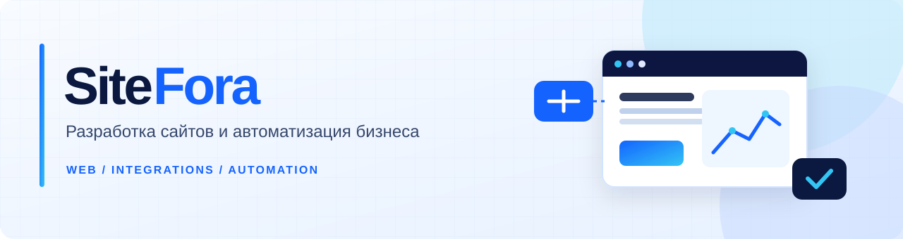

 

### Сайты, которые работают на ваш бизнес.

**Разрабатываем сайты, подключаем сервисы и автоматизируем процессы.**  
От первой идеи и дизайна до запуска, интеграций и дальнейшего развития проекта.

 

---

## Чем мы занимаемся

<table>
<tr>
<td width="50%" valign="top">

### ◈ Разработка сайтов
Лендинги, сайты-визитки и корпоративные сайты с понятной структурой, адаптивным интерфейсом и вниманием к деталям.

</td>
<td width="50%" valign="top">

### ◈ Интеграции
Соединяем сайт с Telegram, CRM и другими инструментами, чтобы заявки и данные попадали туда, где с ними удобно работать.

</td>
</tr>
<tr>
<td width="50%" valign="top">

### ◈ Автоматизация
Убираем повторяющиеся ручные операции: уведомления, обработку данных, внутренние инструменты и типовые рабочие сценарии.

</td>
<td width="50%" valign="top">

### ◈ Развитие проектов
Помогаем развивать функциональность, улучшать производительность и поддерживать техническую часть продукта.

</td>
</tr>
</table>

## Наш подход

**01 — Разобраться.** Изучаем задачу, аудиторию и бизнес-процесс. Не начинаем с выбора модного фреймворка.

**02 — Спроектировать.** Продумываем структуру, пользовательский путь и необходимые интеграции до реализации.

**03 — Разработать.** Пишем поддерживаемый код, проверяем основные сценарии и учитываем адаптивность, безопасность и скорость загрузки.

**04 — Развивать.** Закладываем возможности для дальнейших изменений вместо одноразовых решений.

## Технологии

> Подбираем технологии под задачу, а не задачу под технологии. Часть инструментов применяется в наших проектах, часть — в разработке и инфраструктуре.

## Давайте обсудим ваш проект

Нужен новый сайт, интеграция с существующими сервисами или автоматизация рутины? Опишите задачу — обсудим подходящий вариант реализации.

**[sitefora.ru](https://sitefora.ru) · [hello@sitefora.ru](mailto:hello@sitefora.ru)**

SiteFora · Веб-разработка и автоматизация для бизнеса

